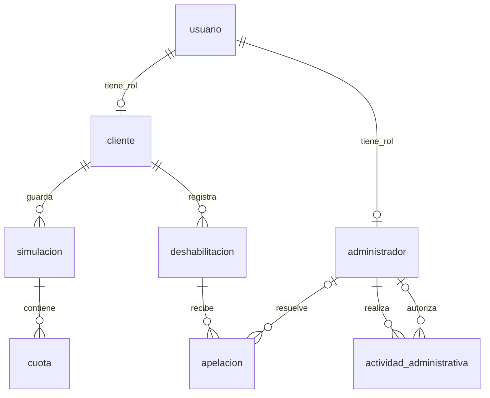

# Base de datos — esquema vigente, datos iniciales y conexión

Consolidación: 25/11/2026. Leer junto a [02_BACKEND_CPP.md](02_BACKEND_CPP.md). Esta documentación no ejecuta SQL, no conecta MySQL y no cambia las tablas.

## 1. Fuente de verdad y alcance

Script vigente: `aplicacion-cpp/bd/Financionanti.sql`, relativo a la raíz del proyecto indicada en [00](00_SISTEMA_Y_REQUERIMIENTOS.md).
Contiene `CREATE DATABASE financionantimex`, `USE`, ocho `CREATE TABLE` y todos los `INSERT INTO`, incluidas las 619 cuotas. No hace falta recrear los inserts a partir de este documento: ejecutar el archivo vigente cuando corresponda instalar una base nueva.
`base-datos/01_esquema_y_muestras.sql` es histórico, contiene decisiones y estructuras descartadas. No ejecutarlo ni tomarlo como migración. Se conserva porque esta tarea elimina solamente documentación Markdown reemplazada.

Es una instalación inicial, **no una migración de una BD existente ni un script idempotente**. Sin `IF NOT EXISTS`, volver a ejecutarlo puede fallar o encontrar IDs repetidos. No agregar `DROP DATABASE` ni borrar datos para resolverlo. Si existe una BD con información, respaldar y diseñar una migración explícita antes de tocarla. Los cambios de estructura MySQL no se revierten como una transacción ordinaria de datos.

El usuario quiere SQL fácil de explicar: `CREATE DATABASE`, `USE`, `CREATE TABLE`, tipos habituales, PK, FK, `AUTO_INCREMENT` e `INSERT INTO`. Se retiraron `BIGINT UNSIGNED`, `UNIQUE`, `CHECK`, índices auxiliares, `DEFAULT`, `ENGINE`, cláusulas `COLLATE`/charset explícitas, `ON DELETE RESTRICT` explícito, `IF NOT EXISTS`, bloques `START TRANSACTION` y consultas de diagnóstico dentro del instalador. No reintroducirlos sin pedirlo. Las transacciones y las consultas de verificación **sí se necesitan en el backend/pruebas**: la simplificación del archivo no las prohíbe.

No perseguir una etiqueta de tercera forma normal a costa de tablas inútiles. Conservar relaciones claras y evitar duplicación. Se retiraron `version_calculo`, `terminos` y `aceptacion_terminos`. No crear tablas de comparaciones, PDF, edad, mensualidades totales, perfiles por pantalla ni un catálogo de métodos que el sistema no ofrece.

## 2. Las ocho tablas en lenguaje sencillo

| Tabla | Para qué sirve | Relación principal |
|---|---|---|
| usuario | Datos comunes de acceso/perfil, foto y última aceptación de términos | Una cuenta con exactamente un rol |
| administrador | Identifica administradores, folio fijo y baja lógica | usuario_id es PK y FK de usuario |
| cliente | Identifica cuentas cliente sin duplicar datos personales | usuario_id es PK y FK de usuario |
| deshabilitacion | Cada episodio de suspensión, motivo y eventual reactivación | Un cliente puede tener varios episodios históricos, solo uno abierto |
| simulacion | Nombre, propietario y condiciones de un préstamo proyectado | Un cliente tiene muchas simulaciones |
| cuota | Interés y capital de cada periodo proyectado | Clave compuesta simulacion_id + numero |
| apelacion | Solicitud de revisión de una suspensión y su resolución | Pertenece a una deshabilitación, no a una cuenta arbitraria |
| actividad_administrativa | Quién hizo qué, cuándo, sobre qué y, si aplica, quién autorizó | Administrador actor y autorizador opcional |

`usuario` no tiene columna rol porque lo identifican `cliente` o `administrador`. El servicio debe crear una y solo una especialización en la misma transacción que el usuario. El SQL actual no impide que alguien inserte manualmente ambas o ninguna: el backend debe detectarlo y no autenticar una cuenta ambigua.

Relaciones:



El diagrama permite mostrar los roles opcionales por separado; la exclusión entre ambos es una regla del servicio. Una simulación guardada válida tiene exactamente `meses` cuotas, aunque las FK por sí solas permiten cero. `entidad` + `entidad_id` de actividad son una referencia descriptiva a objetos distintos; no constituyen una FK genérica.

## 3. Significado de campos y valores nulos

- `usuario.nombre` guarda **solo Nombre(s)**. Los apellidos están separados. El saludo usa nombre; directorios/fichas usan nombre completo. Las relaciones usan ID, no el correo mutable ni el nombre.
- `nacimiento` es DATE; la edad se calcula con fecha actual. No guardar una edad que envejezca incorrectamente. Las validaciones de mayoría de edad son C++.
- `password_hash` es el formato PBKDF2 descrito en 02, con sal/parámetros. NULL significa contraseña **pendiente de establecer**. No significa acceso sin contraseña. No guardar texto plano ni el hash temporal simple de la UI.
- `foto_ruta` NULL usa el avatar de usuario existente. Una ruta futura apunta a almacenamiento gestionado por la aplicación, preferentemente relativa al directorio de datos; no al archivo original en Descargas. La imagen no se guarda como BLOB por ahora.
- `creado_en` es creación de cuenta; `ultimo_acceso` es último login completado según política de sesión. Las semillas con NULL no han recibido una fecha inventada. Mostrar «Sin acceso».
- `terminos_version` y `terminos_aceptados_en` guardan **la última aceptación explícita**. No existe historial de todas las versiones ni evidencia de comprensión. Las semillas ya incluyen aceptación inicial por declaración del propietario. El texto/versionado están en `TerminosRegistro.h`.
- `administrador.folio` se genera una sola vez, longitud 13; no cambia al editar nombre/nacimiento. En el SQL actual está legible: no afirmar que está cifrado. La aplicación no debe exponerlo en consultas normales ni en logs. El flujo de revelación propio requiere autorización de otro administrador. Este mecanismo no protege frente a quien tiene acceso root al servidor local.
- `administrador.eliminado_en` NULL significa disponible; con fecha está dado de baja lógicamente. Conservar su usuario e IDs para apelaciones/actividad. Excluir de login y autorización.
- `deshabilitacion.reactivada_en` NULL significa suspensión abierta. No más de una abierta por cliente. Una suspensión abierta prevalece sobre activo/inactivo. No se guarda un booleano separado que pueda contradecirla.
- `simulacion.creada_en` no cambia al editar; `actualizada_en` sí. `eliminada_en` NULL aparece en consultas operativas; con fecha se conserva pero queda oculta. `moneda` será MXN; frecuencia mensual es fija y no requiere columna adicional.
- `cuota.numero` empieza en 1 y termina en meses, sin huecos ni repetidos. No representa un cobro real efectuado; son pagos **proyectados**.
- `apelacion.estado` usa los valores iniciales `PENDIENTE` y, para resoluciones futuras, `APROBADA`/`RECHAZADA`. No es un enum SQL: validar valores en C++. Al estar pendiente, respuesta/resuelta_en/resuelta_por son NULL. Rechazo requiere respuesta; aprobación registra responsable y fecha.
- `actividad.antes/despues` pueden ser NULL según acción. Serializar datos permitidos como texto/JSON consistente; no passwords, hashes, sales ni folios. `autorizador_id` identifica al tercero cuando revela folio; no reemplaza al actor. No precargar acciones ficticias como sucesos reales.

La nulabilidad y tamaño SQL no sustituyen reglas. Ejemplo: `simulacion.nombre VARCHAR(160)` admite más que el límite funcional de 50, y tasa tiene cuatro decimales mientras UI admite dos. El servicio aplica el contrato estricto del PDF corregido. No hace falta alterar SQL para añadir todas las validaciones solicitadas en C++.

## 4. Cómo obtener la tabla y los resultados sin duplicarlos

Leer condiciones y cuotas ordenadas por numero desde una vista consistente de la BD. Con montos en centavos/decimales exactos:

```text
saldoInicial(1) = simulacion.monto
pago(i) = cuota.interes(i) + cuota.abono_capital(i)
saldoFinal(i) = saldoInicial(i) - cuota.abono_capital(i)
saldoInicial(i+1) = saldoFinal(i)
interesesTotales = suma de interes
capitalTotal = suma de abono_capital = monto
totalPagar = suma de pago = monto + interesesTotales
saldoFinal(ultimo) = 0.00
```

La mensualidad regular se calcula con el mismo motor/redondeo; el último pago puede ajustar centavos. Mostrar ese ajuste, no multiplicar ciegamente pago regular por meses como total. Nunca sumar la columna saldo para obtener un total financiero.
Historial, detalle, comparador, ficha administrativa y PDF leen la MISMA simulación y sus cuotas. PDF es un archivo generado bajo petición, no otra tabla. Comparar tampoco modifica registros ni necesita tabla propia.

Al editar monto/tasa/plazo, el servicio calcula primero, después reemplaza cuotas y actualiza condiciones dentro de una transacción. `DELETE FROM cuota WHERE simulacion_id=:id` para sustituir las cuotas de una edición es distinto del borrado de una simulación. Al borrar una simulación se conservan sus cuotas y se marca `eliminada_en`.
No existe un histórico completo de versiones matemáticas: actividad conserva el resumen antes/después administrativo. No prometer reconstruir todas las cuotas antiguas editadas. El usuario prefirió esta simplificación y no pidió restauración.

## 5. Conexión C++ / Qt con MySQL local

Workbench sirve para ejecutar/revisar SQL; la aplicación se conecta a **MySQL Server** mediante Qt SQL / driver `QMYSQL`.

Configuración local solicitada: usuario `root`, base `financionantimex`. Host habitual `127.0.0.1`, puerto habitual `3306`: verificarlos en la conexión local de Workbench, no asumir que se probaron. El propietario proporcionó su contraseña local en conversación; **no se reproduce en estos documentos ni se incorpora al repositorio**. Pedirla al configurar o cargarla de configuración privada fuera de Git. No confundir contraseña root con contraseñas de los usuarios de la aplicación.

Secuencia de integración:

1. Confirmar que MySQL Server está instalado, servicio iniciado y conexión de Workbench funciona. Instalar Workbench no demuestra que exista servidor.
2. Confirmar versión del servidor, soporte transaccional de tablas y codificación que conserve español. Al no imponer ENGINE/charset en SQL, comprobar sus valores reales antes de considerar válida la instalación.
3. Revisar/ejecutar `Financionanti.sql` en una base nueva de pruebas, no contra datos que deban conservarse. No ejecutarlo automáticamente en cada arranque de la app.
4. Añadir `Sql` y `Network` a los componentes/link de CMake además de `Widgets`; Network se usa para QPasswordDigestor, sin requerir conexión a internet.
5. Comprobar `QSqlDatabase::drivers()` y disponibilidad de `QMYSQL`. El plugin y biblioteca cliente deben ser compatibles con Qt 6.12, MinGW, arquitectura 64 bits y build empleado. No copiar DLL aleatorias ni mezclar kits. Si no está el plugin, resolver instalación/compilación compatible según entorno real.
6. Abrir una conexión con nombre; fijar host/puerto/base/usuario/contraseña desde configuración local. Ejecutar una consulta mínima y consultar errores sin imprimir secretos.
7. Implementar repositorios con `prepare`/`bindValue`, conexión válida en el hilo que la usa y vida útil controlada. Cerrar consultas antes de retirar una conexión.
8. El script vigente ya contiene hashes PBKDF2 iniciales compatibles con Claves::verificar. No ejecutar ningún bootstrap en cada arranque. Un hash NULL nunca autentica.
9. Conectar pantallas progresivamente, sustituir listas locales y probar persistencia tras cerrar/abrir.

Usar root es la decisión local de este proyecto; no publicar/distribuir esa credencial ni convertirla en constante del ejecutable. Si más adelante se instala para terceros o en red, revisar cuenta SQL de permisos mínimos y seguridad del despliegue: eso no forma parte del alcance actual.

## 6. Consultas y operaciones que deberá realizar el backend

Fragmentos orientativos, **no ejecutados**. Los nombres `:id`, `:cliente`, etc. se enlazan con `bindValue`; nunca concatenar entradas de usuario. El servicio verifica rol/sesión antes de consultar.

```sql
-- Historial del cliente activo: nunca incluir registros eliminados.
SELECT id, nombre, monto, tasa_anual, meses, moneda, creada_en, actualizada_en
FROM simulacion
WHERE cliente_id = :cliente AND eliminada_en IS NULL
ORDER BY creada_en DESC, id DESC;

-- Obtener un registro propio antes de abrir, exportar, comparar o eliminar.
SELECT id, cliente_id, nombre, monto, tasa_anual, meses, moneda
FROM simulacion
WHERE id = :id AND cliente_id = :cliente AND eliminada_en IS NULL;

-- Solo tras comprobar acceso a la simulación.
SELECT numero, interes, abono_capital
FROM cuota WHERE simulacion_id = :id ORDER BY numero;

-- Eliminación por cliente; el servicio comprueba filas afectadas.
UPDATE simulacion SET eliminada_en = :ahora, actualizada_en = :ahora
WHERE id = :id AND cliente_id = :cliente AND eliminada_en IS NULL;

-- Estado de cuenta cliente.
SELECT id, motivo, creada_en
FROM deshabilitacion
WHERE cliente_id = :cliente AND reactivada_en IS NULL;

-- Listar administradores sin exponer folios ni hashes.
SELECT u.id, u.nombre, u.apellido_paterno, u.apellido_materno,
       u.correo, u.nacimiento, u.foto_ruta
FROM usuario u JOIN administrador a ON a.usuario_id = u.id
WHERE a.eliminado_en IS NULL;
```

La operación administrativa sobre una simulación no usa el ID del admin como cliente_id: valida permisos, identifica al propietario objetivo y registra el evento. El acceso de un cliente sí exige su propio ID siempre. `foto_ruta` debe resolverse solo dentro del almacenamiento gestionado.

Para actividad usar rangos `creada_en >= :desde` y `creada_en < :diaSiguienteAHasta`, orden descendente por fecha e ID, ocho resultados por página. Al cambiar filtros reiniciar página; contar y calcular métricas con las mismas condiciones. JOIN con usuario conserva identificación de administradores eliminados. Las opciones de ORDER BY salen de una lista fija en C++, no de texto del buscador.
Si la búsqueda se define literal, escapar `%` y `_` antes de construir el valor LIKE; enlazar el patrón como dato. Buscar sin acentos/mayúsculas puede normalizarse en C++ en este alcance local, o resolverse de forma deliberada tras verificar la collation del servidor; no asumirla.

### Operaciones atómicas

| Operación | Debe confirmarse todo junto |
|---|---|
| Registro | usuario + cliente + aceptación de términos |
| Alta administrador | usuario + administrador/folio + actividad |
| Guardar simulación | condiciones + todas las cuotas |
| Editar simulación por admin | condiciones + sustitución completa de cuotas + actividad |
| Eliminar simulación por admin | fecha de eliminación + actividad |
| Deshabilitar cliente | episodio nuevo + actividad |
| Aprobar apelación | resolución + reactivación del episodio + actividad |
| Rechazar apelación | resolución/motivo + actividad, sin reactivación |
| Editar/eliminar admin | cambios o baja lógica + actividad |

Usar `QSqlDatabase::transaction()`, comprobar cada consulta, `commit()` y `rollback()` si falla. Evitar doble clic y escrituras paralelas no coordinadas. Archivo de foto y BD no comparten transacción: escribir nuevo archivo temporal/gestionado, confirmar actualización y limpiar o revertir en caso de fallo; no borrar la foto anterior antes del éxito.

La unicidad de correo/folio y una sola apelación pendiente se validan en servicio. Sin UNIQUE/CHECK, escribir directamente desde Workbench puede violar esas reglas. Para la aplicación local serializar escrituras; si se admiten múltiples instancias/procesos, definir coordinación explícita antes de prometer ausencia de carreras. Una transacción por sí sola no convierte cualquier consulta previa en garantía de unicidad.

## 7. Datos iniciales que se deben conservar

Inventario del SQL vigente. Son datos iniciales de instalación. El propietario declaró aceptados los términos para estas cuentas y autorizó establecer sus claves; las fechas de semilla siguen siendo convenciones del conjunto inicial.

| Tabla | Filas iniciales |
|---|---:|
| usuario | 12 |
| administrador | 5 |
| cliente | 7 |
| deshabilitacion | 1 |
| simulacion | 36 |
| cuota | 619 |
| apelacion | 1 |
| actividad_administrativa | 0 |

Los cinco administradores son iguales en permisos. No existe máximo de cinco. Los folios iniciales se incluyen para el traspaso del proyecto local; no exponerlos desde la interfaz ni publicar esta documentación con datos personales/folios como manual público.

| ID | Nombre(s) | Paterno | Materno | Nacimiento | Correo | Folio inmutable |
|---:|---|---|---|---|---|---|
| 1 | Enrique | López | Garfias | 31/03/2007 | lopez.garfias.enrique@gmail.com | ENR310307GB34 |
| 2 | Pedro | Pescador | Velázquez | 09/05/2007 | pescador.velazquez.pedro@gmail.com | PED090507XJ87 |
| 3 | Uziel Alexander | Pimentel | Ramírez | 21/12/2007 | uzielpime@gmail.com | UZI211207CY79 |
| 4 | Alexander | Mendoza | Jiménez | 22/09/2005 | alexxaanderjimenez@gmail.com | ALE220905FQ64 |
| 5 | Christian Jared | Castillo | Hernández | 27/09/2007 | tcrid67@gmail.com | JAR270907WW20 |

Christian Jared conserva el prefijo histórico JAR; no cambiarlo a CHR al importar. Lo mismo aplica a cualquier folio existente tras editar nombres/nacimiento. Todos estos administradores ya son mayores de edad a la fecha de esta guía. No volver al error de interpretar a Uziel como menor en noviembre de 2026.

| ID | Cliente | Correo | Nacimiento | Último acceso de semilla | Simulaciones |
|---:|---|---|---|---|---:|
| 6 | Ana López Martínez | ana.lopez@example.com | 10/03/1995 | 15/11/2026 | 2 |
| 7 | Luis Pérez Sánchez | luis.perez@example.com | 11/04/1996 | 15/09/2026 | 2 |
| 8 | María Torres Flores | maria.torres@example.com | 12/05/1997 | 15/07/2026 | 2 |
| 9 | Carlos Ruiz Morales | carlos.ruiz@example.com | 13/06/1998 | 15/05/2026 | 2 |
| 10 | Sofía García Vargas | sofia.garcia@example.com | 14/07/1999 | 15/03/2026 | 2 |
| 11 | Diego Hernández Castro | diego.hernandez@example.com | 15/08/2000 | 15/01/2026 | 2 |
| 12 | Valeria Ramírez Mendoza | valeria.ramirez@example.com | 01/01/2000 | NULL | 24 |

Correos example.com son datos iniciales ficticios plausibles, no direcciones verificadas. No agregar un sistema de verificación por correo no solicitado. Los IDs 6–11 conservan dos préstamos individuales cada uno: Computadora 12,000 MXN/0 %/3 meses y Estudios 24,000 MXN/12 %/12 meses. No son dos registros compartidos entre todos.
La cuenta Valeria recibe los 20 préstamos históricos y cuatro variantes adicionales del comparador. Esta asignación ya está en el SQL; el frontend antiguo no tenía un propietario persistido de esas listas. No replicar las 24 simulaciones a cada nuevo cliente.

Los 12 password_hash contienen PBKDF2 con sales independientes. terminos_version es 1 y terminos_aceptados_en usa la fecha de alta de la semilla, por acuerdo del propietario de considerar aceptación previa. foto_ruta y los últimos accesos administrativos siguen NULL. Las claves administrativas fueron proporcionadas por el propietario; las de clientes fueron propuestas y aceptadas. No se incluyen claves legibles en este documento ni en el SQL.
La referencia temporal fija del SQL es 15/11/2026 12:00:00. Son fechas precargadas de la instalación: no regenerarlas con CURRENT_TIMESTAMP en cada arranque ni afirmar que son historial de hechos reales. Algunas fechas de acceso preceden a la fecha común de creación de semilla; si se requiere coherencia histórica estricta, conciliar esas fechas al preparar datos finales, sin inventar una historia de sesiones. No es razón para bloquear el registro normal.
Ana tiene suspensión ID1, motivo Inactividad, abierta desde esa fecha. Apelación ID1 pendiente, mismo episodio, texto: «Deseo retomar mis simulaciones y solicito reactivar mi cuenta.». No tiene respuesta ni administrador resolutor. El motivo histórico no cambia automáticamente por su último acceso precargado.

## 8. Diferencias del prototipo que no deben migrarse literalmente

- PanelAdministrador genera seis clientes con correos `cliente1@demo.mx`…`cliente6@demo.mx` y accesos relativos al día actual. SQL usa nombres completos/correos/fechas de la sección 7. Adoptar IDs y registros SQL, no fusionarlos por similitud de nombre.
- Mi cuenta mantiene «Cliente de muestra», `cliente@demo.mx`, separado de Ana y Valeria; dejar de usar esa variable global al autenticar. Registro temporal tampoco establece automáticamente un usuario SQL.
- Historial tiene 20 objetos locales; comparador seis objetos independientes. Dos ya coinciden con el historial y cuatro son variantes adicionales. SQL conserva 36 simulaciones globales, no 20 ni 38.
- «Curso de idiomas» al 8 %/12 meses y la variante 0 %/10 meses son diferentes. El ID los distingue; el nombre no es PK.
- Comparador tiene intereses precargados 794.25 para Computadora a 12 meses. Las cuotas SQL coherentes suman 794.23. Sustituir la cifra fija, no manipular cuotas para reproducirla.
- `ActividadAdministrativa.h` genera 24 ejemplos de interfaz. No insertarlos como sucesos reales ni crear `actividad_demo` en el esquema final. Actividad inicia vacía y se alimenta de cambios ejecutados.
- Las fotografías/ediciones hechas en una ejecución antigua no persisten. No se puede prometer recuperarlas desde SQL sin haberlas guardado.
- No hay versiones antiguas de cuotas ni historial de todas las versiones de términos. Solo se almacena la última aceptación.
- Hay un nombre de simulación con paréntesis: «Curso de idiomas (10 meses sin interés)». RN-12 permite letras/números/espacios/guion bajo. **Pendiente al integrar**: renombrar a «Curso de idiomas 10 meses sin interés» preservando ID y condiciones. Esta tarea de documentación no modifica ese INSERT.

## 9. Verificación y pendientes de BD

Se hizo lectura del SQL y comprobación mediante una adaptación sintáctica a SQLite en memoria con FK habilitadas: conteos, referencias, secuencias de cuotas, capital y saldos. Eso **no valida compatibilidad ni ejecución en MySQL**. No se ha acreditado aquí que la conexión real esté operativa.

Antes de declarar integración terminada:

- Verificar instalación MySQL, codificación, motor transaccional y QMYSQL.
- Ejecutar instalación en entorno de pruebas y contrastar conteos/secuencias/sumas sin añadir consultas extra al instalador que el usuario pidió sencillo.
- Credenciales y aceptación inicial resueltas en los INSERT por autorización expresa; conservar la aceptación manual para nuevas cuentas.
- Probar errores SQL y rollback, doble envío, borrado lógico, no acceso a registros ajenos, conservación de referencias tras baja de admin y vista de todas las acciones por todos los administradores.
- Confirmar fotos/ediciones después de reiniciar; perfil y saludo deben pertenecer a la sesión real.
- Corregir nombre incompatible de semilla y límites funcionales del código; retirar texto de demostración solo al sustituir sus datos/operaciones.
- No modificar estructura para incluir reglas que pueden expresarse con las ocho tablas actuales sin una razón nueva.

Los siguientes anexos son una fotografía del archivo vigente para facilitar revisión. Si el SQL cambia después, actualizar estos anexos; el ejecutable no debe leer documentación para trabajar.
## Anexo A. Inventario exacto de simulaciones

ID de propietario corresponde a usuario/cliente en sección 7. Importes MXN; tasas nominales anuales. Primer/último pago e intereses se derivaron de las cuotas INSERT existentes, no de constantes del comparador.

| ID | Cliente ID | Nombre | Monto | Tasa % | Meses | Primer pago | Último pago | Intereses | Total |
|---:|---:|---|---:|---:|---:|---:|---:|---:|---:|
| 1 | 6 | Computadora | 12,000.00 | 0 | 3 | 4,000.00 | 4,000.00 | 0.00 | 12,000.00 |
| 2 | 6 | Estudios | 24,000.00 | 12 | 12 | 2,132.37 | 2,132.37 | 1,588.44 | 25,588.44 |
| 3 | 7 | Computadora | 12,000.00 | 0 | 3 | 4,000.00 | 4,000.00 | 0.00 | 12,000.00 |
| 4 | 7 | Estudios | 24,000.00 | 12 | 12 | 2,132.37 | 2,132.37 | 1,588.44 | 25,588.44 |
| 5 | 8 | Computadora | 12,000.00 | 0 | 3 | 4,000.00 | 4,000.00 | 0.00 | 12,000.00 |
| 6 | 8 | Estudios | 24,000.00 | 12 | 12 | 2,132.37 | 2,132.37 | 1,588.44 | 25,588.44 |
| 7 | 9 | Computadora | 12,000.00 | 0 | 3 | 4,000.00 | 4,000.00 | 0.00 | 12,000.00 |
| 8 | 9 | Estudios | 24,000.00 | 12 | 12 | 2,132.37 | 2,132.37 | 1,588.44 | 25,588.44 |
| 9 | 10 | Computadora | 12,000.00 | 0 | 3 | 4,000.00 | 4,000.00 | 0.00 | 12,000.00 |
| 10 | 10 | Estudios | 24,000.00 | 12 | 12 | 2,132.37 | 2,132.37 | 1,588.44 | 25,588.44 |
| 11 | 11 | Computadora | 12,000.00 | 0 | 3 | 4,000.00 | 4,000.00 | 0.00 | 12,000.00 |
| 12 | 11 | Estudios | 24,000.00 | 12 | 12 | 2,132.37 | 2,132.37 | 1,588.44 | 25,588.44 |
| 13 | 12 | Computadora | 12,000.00 | 0 | 3 | 4,000.00 | 4,000.00 | 0.00 | 12,000.00 |
| 14 | 12 | Computadora a 6 meses | 12,000.00 | 0 | 6 | 2,000.00 | 2,000.00 | 0.00 | 12,000.00 |
| 15 | 12 | Automóvil | 180,000.00 | 14.5 | 48 | 4,964.03 | 4,964.08 | 58,273.49 | 238,273.49 |
| 16 | 12 | Estudios universitarios | 45,000.00 | 10 | 24 | 2,076.52 | 2,076.54 | 4,836.50 | 49,836.50 |
| 17 | 12 | Remodelación de cocina | 65,000.00 | 16 | 36 | 2,285.21 | 2,285.07 | 17,267.42 | 82,267.42 |
| 18 | 12 | Motocicleta | 38,000.00 | 18 | 24 | 1,897.12 | 1,896.97 | 7,530.73 | 45,530.73 |
| 19 | 12 | Viaje familiar | 25,000.00 | 12 | 12 | 2,221.22 | 2,221.23 | 1,654.65 | 26,654.65 |
| 20 | 12 | Equipo de fotografía | 32,000.00 | 15 | 18 | 1,996.31 | 1,996.38 | 3,933.65 | 35,933.65 |
| 21 | 12 | Muebles para el hogar | 28,000.00 | 9.5 | 12 | 2,455.14 | 2,455.13 | 1,461.67 | 29,461.67 |
| 22 | 12 | Paneles solares | 85,000.00 | 11 | 36 | 2,782.79 | 2,782.85 | 15,180.50 | 100,180.50 |
| 23 | 12 | Herramientas de trabajo | 18,500.00 | 13 | 18 | 1,136.78 | 1,136.79 | 1,962.05 | 20,462.05 |
| 24 | 12 | Curso de idiomas | 15,000.00 | 8 | 12 | 1,304.83 | 1,304.79 | 657.92 | 15,657.92 |
| 25 | 12 | Consultorio dental | 120,000.00 | 17 | 48 | 3,462.61 | 3,462.31 | 46,204.98 | 166,204.98 |
| 26 | 12 | Negocio de repostería | 55,000.00 | 14 | 24 | 2,640.71 | 2,640.66 | 8,376.99 | 63,376.99 |
| 27 | 12 | Reparación de automóvil | 22,000.00 | 19 | 12 | 2,027.44 | 2,027.51 | 2,329.35 | 24,329.35 |
| 28 | 12 | Equipo de sonido | 16,500.00 | 12.5 | 18 | 1,010.04 | 1,010.05 | 1,680.73 | 18,180.73 |
| 29 | 12 | Bicicleta eléctrica | 27,000.00 | 10.5 | 24 | 1,252.15 | 1,252.22 | 3,051.67 | 30,051.67 |
| 30 | 12 | Gastos médicos | 40,000.00 | 9 | 24 | 1,827.39 | 1,827.39 | 3,857.36 | 43,857.36 |
| 31 | 12 | Teléfono móvil | 14,000.00 | 0 | 12 | 1,166.67 | 1,166.63 | 0.00 | 14,000.00 |
| 32 | 12 | Ampliación de vivienda | 150,000.00 | 15.5 | 60 | 3,607.98 | 3,607.86 | 66,478.68 | 216,478.68 |
| 33 | 12 | Computadora a 12 meses | 12,000.00 | 12 | 12 | 1,066.19 | 1,066.14 | 794.23 | 12,794.23 |
| 34 | 12 | Muebles a 12 meses | 24,000.00 | 0 | 12 | 2,000.00 | 2,000.00 | 0.00 | 24,000.00 |
| 35 | 12 | Muebles a 24 meses | 24,000.00 | 0 | 24 | 1,000.00 | 1,000.00 | 0.00 | 24,000.00 |
| 36 | 12 | Curso de idiomas (10 meses sin interés) | 15,000.00 | 0 | 10 | 1,500.00 | 1,500.00 | 0.00 | 15,000.00 |

## Anexo B. DDL actual de referencia

Huella SHA-256 del archivo SQL completo revisado: `be85d2eab45ce40480e7018e054c719384d5ec9060b2557859103c1d0bba697c`. Incluye el esquema y los INSERT; no significa que haya sido ejecutado en MySQL.

```sql
-- Esquema simplificado para FinancionantiMex. Instalación nueva; no migra una BD existente.
-- Validaciones de negocio a cargo del backend.

CREATE DATABASE financionantimex;
USE financionantimex;
CREATE TABLE usuario (
 id INT PRIMARY KEY AUTO_INCREMENT,
 nombre VARCHAR(120),
 apellido_paterno VARCHAR(80),
 apellido_materno VARCHAR(80),
 correo VARCHAR(254),
 nacimiento DATE,
 password_hash VARCHAR(255) NULL,
 foto_ruta VARCHAR(512) NULL,
 creado_en DATETIME,
 ultimo_acceso DATETIME NULL,
 terminos_version VARCHAR(32) NULL,
 terminos_aceptados_en DATETIME NULL
);
CREATE TABLE administrador (
 usuario_id INT PRIMARY KEY,
 folio CHAR(13),
 eliminado_en DATETIME NULL,
 FOREIGN KEY(usuario_id) REFERENCES usuario(id)
);
CREATE TABLE cliente (
 usuario_id INT PRIMARY KEY,
 FOREIGN KEY(usuario_id) REFERENCES usuario(id)
);
CREATE TABLE deshabilitacion (
 id INT PRIMARY KEY AUTO_INCREMENT,
 cliente_id INT,
 motivo TEXT,
 creada_en DATETIME,
 reactivada_en DATETIME NULL,
 FOREIGN KEY(cliente_id) REFERENCES cliente(usuario_id)
);
CREATE TABLE simulacion (
 id INT PRIMARY KEY AUTO_INCREMENT,
 cliente_id INT,
 nombre VARCHAR(160),
 monto DECIMAL(15,2),
 tasa_anual DECIMAL(7,4),
 meses INT,
 moneda CHAR(3),
 creada_en DATETIME,
 actualizada_en DATETIME,
 eliminada_en DATETIME NULL,
 FOREIGN KEY(cliente_id) REFERENCES cliente(usuario_id)
);
CREATE TABLE cuota (
 simulacion_id INT,
 numero INT,
 interes DECIMAL(17,2),
 abono_capital DECIMAL(15,2),
 PRIMARY KEY(simulacion_id,numero),
 FOREIGN KEY(simulacion_id) REFERENCES simulacion(id)
);
CREATE TABLE apelacion (
 id INT PRIMARY KEY AUTO_INCREMENT,
 deshabilitacion_id INT,
 mensaje TEXT,
 estado VARCHAR(20),
 respuesta TEXT NULL,
 creada_en DATETIME,
 resuelta_en DATETIME NULL,
 resuelta_por INT NULL,
 FOREIGN KEY(deshabilitacion_id) REFERENCES deshabilitacion(id),
 FOREIGN KEY(resuelta_por) REFERENCES administrador(usuario_id)
);
CREATE TABLE actividad_administrativa (
 id INT PRIMARY KEY AUTO_INCREMENT,
 administrador_id INT,
 autorizador_id INT NULL,
 accion VARCHAR(64),
 entidad VARCHAR(32),
 entidad_id INT NULL,
 descripcion TEXT,
 antes TEXT NULL,
 despues TEXT NULL,
 creada_en DATETIME,
 FOREIGN KEY(administrador_id) REFERENCES administrador(usuario_id),
 FOREIGN KEY(autorizador_id) REFERENCES administrador(usuario_id)
);
```

## Anexo C. Receta para comprobar los INSERT

En una base de pruebas, contar las ocho tablas y contrastar la sección 7; verificar rol exclusivo y propietarios; para cada simulación recuperar cuotas ordenadas, comprobar número consecutivo 1..meses, capital/interés no negativos, suma capital=monto, saldo final=0 y total=monto+suma intereses. Comparar con anexo A. Estas comprobaciones pertenecen a pruebas/diagnóstico, no se añaden al instalador sencillo. No ejecutar el script histórico ni volver a insertar estos datos al iniciar sesión.

## Conexión implementada — 25/11/2026
Se añadió ConexionBD (Qt SQL, conexión nombrada con cierre al salir). main abre
financionantimex y comprueba SELECT COUNT(*) FROM usuario antes de mostrar acceso.
Un error detiene el arranque con mensaje; no se ejecuta el instalador SQL.
En la entrega del 25/11 solo se conectó MySQL. La actualización del 26/11, descrita abajo, implementa autenticación y registro.

Configuración privada: conexion.local.ini, grupo mysql, campos host, puerto, base,
usuario y clave. Está excluida de Git y contiene la clave local en texto plano.
Se busca FINANCIONANTI_CONFIG, después junto al ejecutable y finalmente en la
carpeta fuente local. No compartir ese archivo. La variable explícita no usa fallback.

QMYSQL fue compilado desde qt/qtbase v6.12.0, commit
025bdad181de241e81bf853c8a2d7bf3d19261a9, con MinGW 15.1 y libmysql de Server 8.0.
runtime/ (local, excluido de Git) contiene sqldrivers/qsqlmysql.dll, libmysql.dll,
libssl-3-x64.dll y libcrypto-3-x64.dll. CMake copia ese contenido al ejecutable.
En otro equipo hay que preparar esas dependencias compatibles y su configuración.
Fuentes y build auxiliares: build-qmysql-src y build-qmysql. Se desactivaron
sql_sqlite y sql_odbc; el comando windres generado requirió retirar $INCLUDES
por el manejo de espacios de rutas en su preprocesador. No se modificó Qt global.

Verificación: compilación correcta y ejecución --comprobar-bd con salida 0:
“Conexion MySQL y lectura de usuario correctas.” La primera ejecución aislada
falló con 2003; fuera del aislamiento la consulta fue correcta.
Esto prueba conexión y lectura, no una auditoría completa del esquema ni escrituras.


## Instalación lista para ejecutar — 26/11/2026
Abrir bd/Financionanti.sql en Workbench y ejecutar el archivo completo sobre una
instancia donde financionantimex no exista. El propietario acordó borrar primero
su base anterior. El script no incluye DROP DATABASE ni UPDATE posteriores:
CREATE DATABASE, USE, ocho tablas e INSERT con hashes/términos incluidos.
Conservar los 36 préstamos y 619 cuotas originales. Ninguna reinstalación automática.

Se instaló el archivo completo en una base MySQL separada, cambiando únicamente
su nombre para las pruebas. Se verificaron ocho tablas InnoDB, conteos, hashes y
operaciones de registro/login. La base real financionantimex no fue borrada ni
actualizada por esta entrega; falta que el propietario ejecute el script allí.
Los registros creados por las pruebas quedan solo en la base separada.

Los hashes iniciales fueron generados con PBKDF2 estándar y comprobados con la
implementación Qt de la aplicación para las 12 contraseñas. Las sales son diferentes.
No se requiere establecer contraseñas manualmente después de ejecutar el instalador.

La compilación Debug que usa Qt Creator también terminó correctamente y pasó
--comprobar-bd con código 0. El kit MinGW instalado utiliza las bibliotecas Qt
Release; el mismo controlador local QMYSQL funciona en esta configuración Debug.
No hace falta sustituir los plugins de la instalación global de Qt.

## Perfil propio persistente — 26/11/2026
Mi cuenta y la ficha del administrador en sesión guardan datos y foto propios.
Validaciones compartidas: nombre y ambos apellidos obligatorios, letras/espacios y
máximo 40 caracteres; correo válido y único entre todas las cuentas; mayoría de edad;
nueva contraseña de 8–15 caracteres, mayúscula, minúscula, número y símbolo, sin espacios.
Para cambiarla se verifica la contraseña actual y se rechaza reutilizarla. Ambos campos
nuevos vacíos conservan la contraseña. Se rechaza guardar cuando no hay cambios reales.
ServicioAcceso revalida el rol/estado, usa transacción y bloqueo compartido con registro.
Los editores esperan el resultado fuera del hilo gráfico antes de actualizar las vistas.

Foto: se conserva selección/recorte; se limita entrada a 10 MiB y 12000 píxeles por lado,
y se guarda PNG 512×512 en AppDataLocation/fotos. MySQL guarda foto_ruta, no los bytes.
Guardar escribe un archivo nuevo, confirma SQL y retira el anterior solo dentro de la
carpeta gestionada. Fallo SQL retira el nuevo; restablecer guarda NULL. La misma foto
se rechaza. Respaldar base y carpeta de fotos juntas. No se requiere modificar el SQL.
Los cambios propios del administrador registran actividad sin claves, hashes ni folios.
Edición administrativa de terceros, directorio de clientes y sus vistas siguen pendientes.

## Guardado de simulaciones — 26/11/2026
Se utiliza el esquema existente: simulacion almacena propietario, nombre, condiciones,
moneda MXN y timestamps del servidor; cuota almacena número, interés y abono a capital.
Saldo y pago son derivados; no se agregaron columnas de totales ni nuevas tablas.
La transacción incluye todas las cuotas. Se revalida cliente vigente antes del INSERT.
Prueba real: lectura desde otra conexión reproduce las cuotas calculadas; un trigger
exclusivo de la base de pruebas falla en la cuota 2 y no deja filas parciales. El trigger
se retira al terminar. La base principal y el instalador no se modificaron en esta etapa.
No hace falta borrar datos ni volver a ejecutar Financionanti.sql para usar el simulador.
